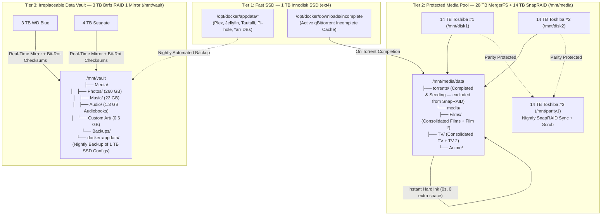

# MageeMedia 2.0 — Linux & Docker Media Server Infrastructure

Configuration, Docker Compose stack, storage definitions, and Windows-to-Linux migration tooling for **MageeMedia** (`192.168.1.237`).

---

## 1. Hardware & Storage Overview

* **Motherboard:** ASUS ROG MAXIMUS VI HERO (Intel Z87)
* **CPU / iGPU:** Intel Core i7-4790 @ 3.60GHz (`Intel HD Graphics 4600` QuickSync VAAPI `/dev/dri`)
* **RAM:** 32 GB DDR3 (used for `/dev/shm` RAM-disk video transcoding)
* **OS:** Ubuntu Server 24.04 LTS

### Physical SATA Port Mapping

| Motherboard Port | Physical Drive | Tier / Role | Filesystem & Mount |
| :--- | :--- | :--- | :--- |
| **`SATA6G_1` (Intel Z87)** | **1 TB Innodisk SSD** (`DES25-01TDK1KCCQL`) | **Tier 1 (OS & AppData):** Ubuntu 24.04 + Docker `/config` + Incomplete Torrent Cache | `ext4` → `/` & `/opt/docker` |
| **`SATA6G_2` (Intel Z87)** | **14 TB Toshiba #1** (`MG07ACA14TE`) | **Tier 2 (Media Pool):** MergerFS Data Disk 1 | `ext4` → `/mnt/disk1` |
| **`SATA6G_3` (Intel Z87)** | **14 TB Toshiba #2** (`MG07ACA14TE`) | **Tier 2 (Media Pool):** MergerFS Data Disk 2 | `ext4` → `/mnt/disk2` |
| **`SATA6G_4` (Intel Z87)** | **14 TB Toshiba #3** (`MG07ACA14TE`) | **Tier 2 (Parity):** SnapRAID Parity Disk (28 TB Protected Pool) | `ext4` → `/mnt/parity1` |
| **`SATA6G_5` (Intel Z87)** | **3 TB WD Blue** (`WD30EZRZ`) | **Tier 3 (Vault RAID 1):** Btrfs RAID 1 Member A | `btrfs` → `/mnt/vault` |
| **`SATA6G_6` (Intel Z87)** | **4 TB Seagate** (`ST4000DM004`) | **Tier 3 (Vault RAID 1):** Btrfs RAID 1 Member B | `btrfs` → `/mnt/vault` |
| **`SATA6G_E1` (ASMedia)** | **64 GB SanDisk SSD** (`SDSSDHP064G`) | **Legacy Fallback:** Old Windows 10 `C:` Drive (Read-Only during migration) | `ntfs3` → `/mnt/win_c` |

---

## 2. Three-Tier Storage Architecture



---

## 3. Repository Structure

```text
MageeMedia/
├── README.md                            # Architecture overview & port directory
├── docs/
│   └── MIGRATION_GUIDE.md               # Step-by-step Windows 10 -> Ubuntu 24.04 migration guide
├── docker/
│   ├── compose.yaml                     # Master Docker Compose stack (Plex, Jellyfin, *arr, Pi-hole, Unbound)
│   ├── .env.example                     # Environment variable template
│   └── unbound/
│       └── pi-hole.conf                 # Unbound recursive DNS-over-TLS configuration
├── config/
│   ├── fstab.example                    # /etc/fstab template for MergerFS, Btrfs RAID 1, and data drives
│   ├── snapraid.conf                    # /etc/snapraid.conf for the 3x 14 TB Toshiba array
│   └── smb.conf.example                 # Samba share definitions (\\192.168.1.237\Media & \Vault)
└── scripts/
    ├── export-windows-configs.ps1       # PowerShell script to export Windows configs & generate Linux Preferences.xml
    ├── setup-ubuntu-host.sh             # Ubuntu 24.04 host bootstrap script (Docker, MergerFS, SnapRAID, Cockpit)
    └── backup-appdata-to-vault.sh       # Nightly cron script for Docker AppData backup + SnapRAID sync
```

---

## 4. Service & Port Directory (`192.168.1.237`)

| Service | LAN URL | Description |
| :--- | :--- | :--- |
| **Cockpit (Ubuntu Host)** | `https://192.168.1.237:9090` | Linux storage, SMART health, Samba, and web terminal |
| **Dockge** | `http://192.168.1.237:5001` | Visual Docker Compose stack & container manager |
| **Plex Media Server** | `http://192.168.1.237:32400/web` | Primary media server (`Magee Plex`) |
| **Jellyfin** | `http://192.168.1.237:8096` | Open-source media server (shares libraries & GPU with Plex) |
| **Jellyseerr (Seerr)** | `http://192.168.1.237:5055` | Movie / TV / Anime request portal (supports Plex & Jellyfin) |
| **Tautulli** | `http://192.168.1.237:8181` | Plex monitoring, analytics, and newsletters |
| **qBittorrent** | `http://192.168.1.237:8080` | Torrent client (downloads to SSD `/incomplete`, moves to `/data/torrents`) |
| **Prowlarr** | `http://192.168.1.237:9696` | Centralized indexer manager for all `*arr` apps |
| **Sonarr** | `http://192.168.1.237:8989` | Automated TV & Anime series management |
| **Radarr** | `http://192.168.1.237:7878` | Automated Film management |
| **Lidarr** | `http://192.168.1.237:8686` | Automated Music management |
| **Readarr** | `http://192.168.1.237:8787` | Automated Audiobook management |
| **Bazarr** | `http://192.168.1.237:6767` | Automated subtitle management |
| **Pi-hole v6 Admin** | `http://192.168.1.237:60080/admin` | Network DNS & ad-blocking dashboard (HTTPS on `:60443`) |
| **Samba Shares** | `\\192.168.1.237\Media` & `\Vault` | SMB network shares for the 28 TB Media Pool and 3 TB RAID 1 Vault |
