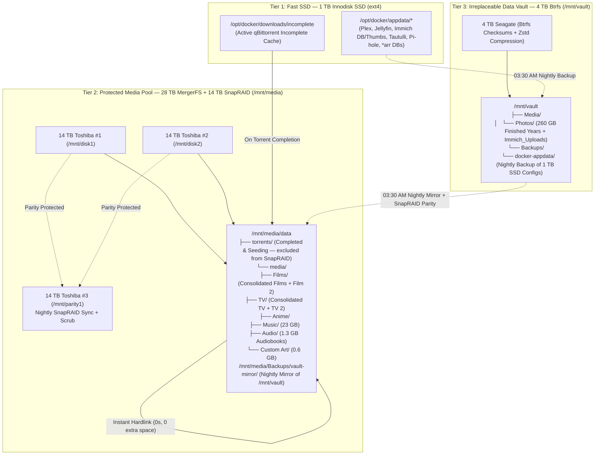

# MageeMedia 2.0 — Linux & Docker Media Server Infrastructure

Configuration, Docker Compose stack, storage definitions, and Windows-to-Linux migration tooling for **MageeMedia** (`192.168.1.237`).

---

## 1. Hardware & Storage Overview

* **Motherboard:** ASUS ROG MAXIMUS VI HERO (Intel Z87)
* **CPU / iGPU:** Intel Core i7-4790 @ 3.60GHz (`Intel HD Graphics 4600` QuickSync VAAPI `/dev/dri`)
* **RAM:** 32 GB DDR3 (used for `/dev/shm` RAM-disk video transcoding)
* **OS:** Ubuntu Server 24.04 LTS + Tailscale Subnet Router (`192.168.1.0/24`)

### Physical SATA Port Mapping (Permanent 5-Drive Layout)

| Motherboard Port | Physical Drive | Tier / Role | Filesystem & Mount |
| :--- | :--- | :--- | :--- |
| **`SATA6G_1` (Intel Z87)** | **14 TB Toshiba #1** (`MG07ACA14TE`) | **Tier 2 (Media Pool):** MergerFS Data Disk 1 | `ext4` → `/mnt/disk1` |
| **`SATA6G_2` (Intel Z87)** | **1 TB Innodisk SSD** (`DES25-01TDK1KCCQL`) | **Tier 1 (OS & AppData):** Ubuntu 24.04 + Docker `/config` + Incomplete Torrent Cache | `ext4` → `/` & `/opt/docker` |
| **`SATA6G_3` (Intel Z87)** | **14 TB Toshiba #2** (`MG07ACA14TE`) | **Tier 2 (Media Pool):** MergerFS Data Disk 2 | `ext4` → `/mnt/disk2` |
| **`SATA6G_4` (Intel Z87)** | **14 TB Toshiba #3** (`MG07ACA14TE`) | **Tier 2 (Parity):** SnapRAID Parity Disk (28 TB Protected Pool) | `ext4` → `/mnt/parity1` |
| **`SATA6G_6` (Intel Z87)** | **4 TB Seagate** (`ST4000DM004`) | **Tier 3 (Vault):** Btrfs Vault with Bit-Rot Checksums (mirrored nightly to 28 TB pool) | `btrfs` → `/mnt/vault` |
| *(Shelf Cold Backup)* | **3 TB WD Blue** (`WD30EZRZ`) | **Offline Cold Backup:** Untouched original Windows media & Plex database | `ntfs` (Offline) |

---

## 2. Three-Tier Storage Architecture

---

## 3. Service & Port Directory (`192.168.1.237`)

| Service | LAN URL | Description |
| :--- | :--- | :--- |
| **Cockpit (Ubuntu Host)** | `https://192.168.1.237:9090` | Linux storage, SMART health, temperatures, Samba, and web terminal |
| **Dockge** | `http://192.168.1.237:5001` | Visual Docker Compose stack & container manager |
| **JellyPlex-Watched** | *Background Service* | Continuous two-way watched status & progress sync between Plex and Jellyfin |
| **Plex Media Server** | `http://192.168.1.237:32400/web` | Primary media server (`Magee Plex`) |
| **Jellyfin** | `http://192.168.1.237:8096` | Open-source media server (shares libraries & GPU with Plex) |
| **Immich** | `http://192.168.1.237:2283` | Self-hosted Google Photos replacement (indexes `/mnt/vault/Media/Photos` + mobile uploads) |
| **Seerr** | `http://192.168.1.237:5055` | Movie / TV / Anime web request portal + Native Plex Watchlist sync (successor to Jellyseerr) |
| **Requestrr** | `http://192.168.1.237:4545` | Telegram / Discord chatbot for external users to request media |
| **Tautulli** | `http://192.168.1.237:8181` | Plex monitoring, analytics, and newsletters |
| **qBittorrent (via ProtonVPN Gluetun)** | `http://192.168.1.237:8080` | Torrent client routed 100% through ProtonVPN WireGuard + NAT-PMP port forwarding |
| **Prowlarr (via ProtonVPN Gluetun)** | `http://192.168.1.237:9696` | Centralized indexer manager routed through ProtonVPN to bypass ISP blocks |
| **FlareSolverr** | `http://192.168.1.237:8191` | Cloudflare / DDoS challenge solver proxy for Prowlarr indexers |
| **Sonarr** | `http://192.168.1.237:8989` | Automated TV & Anime series management |
| **Radarr** | `http://192.168.1.237:7878` | Automated Film management |
| **Lidarr** | `http://192.168.1.237:8686` | Automated Music management |
| **Readarr** | `http://192.168.1.237:8787` | Automated Audiobook management |
| **Bazarr** | `http://192.168.1.237:6767` | Automated subtitle management |
| **Pi-hole v6 Admin** | `http://192.168.1.237:60080/admin` | Network DNS & ad-blocking dashboard (HTTPS on `:60443`, paired with Unbound DoT) |
| **Samba Shares** | `\\192.168.1.237\Media` & `\Vault` | SMB network shares for the 28 TB Media Pool and 4 TB Btrfs Vault |

---

## 4. User Guides & External Access

* **[External User Connection Guide](file:///c:/Users/Charlie/Documents/GitHub/MageeMedia/docs/EXTERNAL_USER_GUIDE.md):** Shareable walkthrough for family and friends on how to connect to Jellyfin, Swiftfin, Plex, Seerr, and Immich across Web, iOS, Android, and Smart TVs.
* **[Automated Schedules & Maintenance Documentation](file:///c:/Users/Charlie/Documents/GitHub/MageeMedia/docs/SCHEDULES_AND_AUTOMATION.md):** Full reference for all recurring background tasks, SnapRAID parity syncs, Btrfs backups, artwork rotation, and systemd maintenance timers.

