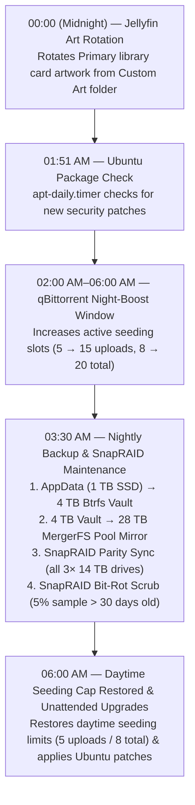

# MageeMedia — Automated Server Schedules & Background Maintenance

This document details all recurring background tasks, cron jobs, systemd timers, and automated container services running on **MageeMedia** (`192.168.1.237`).

---

## 1. Daily Maintenance Timeline (Nightly Window)



---

## 2. High-Frequency & Continuous Tasks (Docker Services & Cron)

| Service / Process | Interval | Description | Log / Monitoring Location |
| :--- | :--- | :--- | :--- |
| **`qbittorrent-seeding-manager.py`** | **Every 1 minute** | Smart seeding & queue manager (`charlie` user cron).<br>• **Daytime (06:00–02:00):** 5 active uploads, 4 downloads, 8 total.<br>• **Night Boost (02:00–06:00):** 15 active uploads, 10 downloads, 20 total.<br>• **Ignore Slow/Stalled:** `dont_count_slow_torrents=True` (< 5 KB/s for 60s) so idle `stalledUP` torrents never waste active slots.<br>• **True Active Seeding Time:** Tracks only real uploading time (`state=uploading` & `upspeed >= 1 KB/s`, ignoring `stalledUP`/`queuedUP`) and pauses torrents at **7 days of active uploading** or **Ratio 2.0**. | `/opt/docker/appdata/qbittorrent/active_seeding_tracker.json` |
| **`jellyplex_watched`** | **Every 15 minutes** | Continuous 2-way watch sync between Plex and Jellyfin. Synchronizes watched status, play counts, and "Continue Watching" playback timestamps for all 6 accounts (`magrizzly`, `Harry`, `Lewis`, `Emily`, `Linda`, `CountCasper`). | `docker logs -f jellyplex_watched` |
| **ProtonVPN Port Sync** | **Continuous / Event-driven** | NAT-PMP port forward handler inside `gluetun`. Automatically pushes dynamically assigned incoming torrent ports to `qBittorrent`'s Web API. | `docker logs -f gluetun` |
| **Sonarr `anime-all-seasons.sh`** | **Event-driven (`On Series Add`)** | Custom script hook in Sonarr (`/config/scripts/anime-all-seasons.sh`). When an anime is requested via Seerr, automatically enables Season Folders, monitors all aired seasons, and triggers a full `SeriesSearch` across all seasons. | Sonarr ➔ System ➔ Events |
| **`*arr` Indexer Sync** | **Every 15–30 minutes** | Sonarr, Radarr, Lidarr, and Readarr poll Prowlarr indexer RSS feeds for requested content. | Web UIs (`:8989`, `:7878`, `:8686`, `:8787`) |
| **`sysstat-collect`** | **Every 10 minutes** | Gathers CPU, memory, and disk I/O metrics for host performance graphs in Cockpit. | Cockpit (`https://192.168.1.237:9090`) |

---

## 3. Daily Schedules

| Time (UTC / UK) | Runner / Trigger | Task / Script | Full Command / Purpose |
| :--- | :--- | :--- | :--- |
| **00:00 (Midnight)** | User Cron (`charlie`) | `rotate-jellyfin-library-art.py` | `/opt/docker/scripts/rotate-jellyfin-library-art.py >> /opt/docker/logs/rotate-jellyfin-art.log 2>&1`<br>Selects random high-resolution artwork from `/mnt/media/data/media/Custom Art/Library/` and updates the Primary library cards in Jellyfin. |
| **00:39 AM** | `systemd` (`logrotate.timer`) | `logrotate` | Compresses and rotates Linux system and Docker logs to protect SSD storage. |
| **01:51 AM** | `systemd` (`apt-daily.timer`) | `apt-daily.service` | Checks official Ubuntu mirrors for package and kernel updates. |
| **03:08 AM** | `systemd` (`systemd-tmpfiles-clean.timer`) | `systemd-tmpfiles-clean` | Cleans expired temporary files in `/tmp` and `/var/tmp`. |
| **03:30 AM** | Root Cron (`root`) | `backup-appdata-to-vault.sh` | `/usr/local/bin/backup-appdata-to-vault.sh >> /var/log/mageemedia-nightly.log 2>&1`<br>**1. AppData Backup:** Copies `/opt/docker/appdata` (Plex, Jellyfin, database states) to `/mnt/vault/Backups/docker-appdata`.<br>**2. Vault Mirror:** Mirrors `/mnt/vault` (Photos + Backups) to `/mnt/media/Backups/vault-mirror`.<br>**3. SnapRAID Parity Sync:** Calculates and writes parity updates to `/mnt/parity1` (`sda1`).<br>**4. SnapRAID Scrub:** Runs `snapraid scrub -p 5 -o 30` to verify data blocks against silent bit-rot. |
| **06:15 AM** | `systemd` (`apt-daily-upgrade.timer`) | `unattended-upgrades` | Installs critical Ubuntu security patches without requiring manual intervention. |

---

## 4. Weekly & Maintenance Schedules

| Day & Time | Runner / Trigger | Task | Purpose |
| :--- | :--- | :--- | :--- |
| **Sunday 03:10 AM** | `systemd` (`e2scrub_all.timer`) | `e2scrub_all` | Online filesystem metadata check for `ext4` media partitions (`disk1`, `disk2`, `parity1`). |
| **Monday 01:13 AM** | `systemd` (`fstrim.timer`) | `fstrim` | Trims unused blocks on the 1 TB Innodisk SSD (`sdb`) to ensure long-term write performance and flash endurance. |

---

## 5. Verification Commands

To check on active tasks, timers, and recent logs:

```bash
# View all scheduled systemd timers and countdowns
systemctl list-timers --no-pager

# View cron configurations
crontab -l          # User cron (art rotation)
sudo crontab -l     # Root cron (nightly backup & SnapRAID)

# View the latest nightly backup & SnapRAID execution log
sudo tail -n 50 /var/log/mageemedia-nightly.log

# View live 2-way watch status sync logs
sudo docker logs --tail 50 -f jellyplex_watched
```
